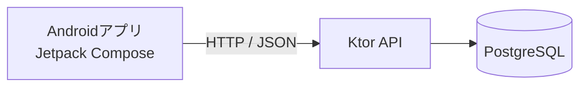
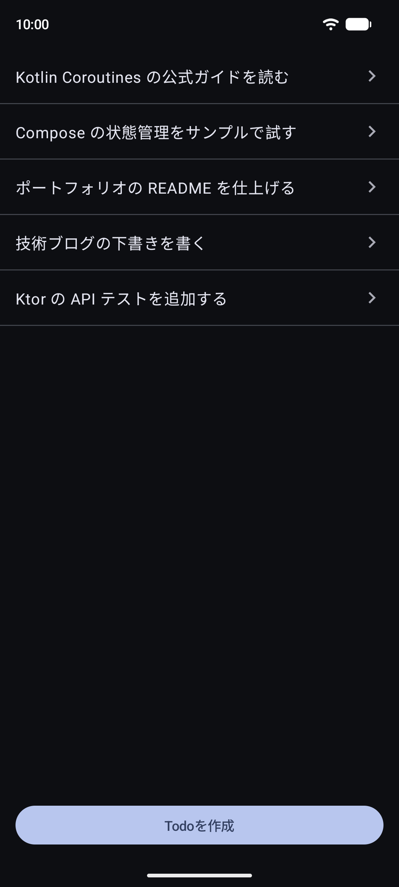
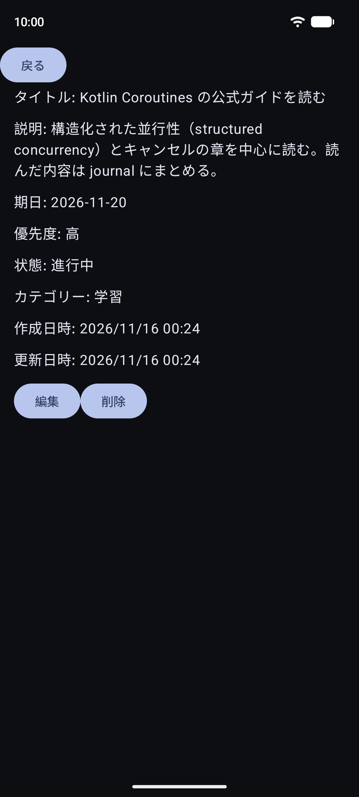
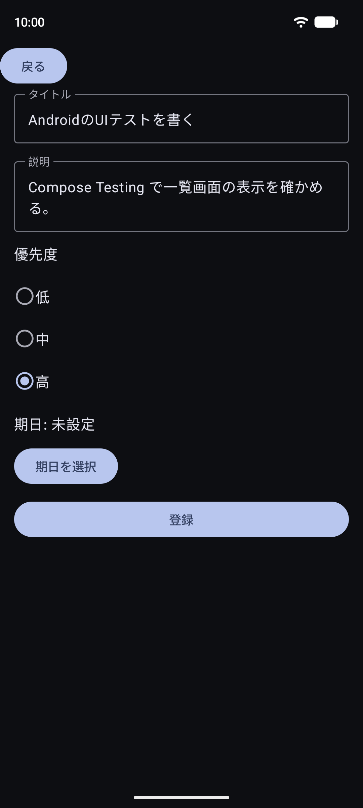
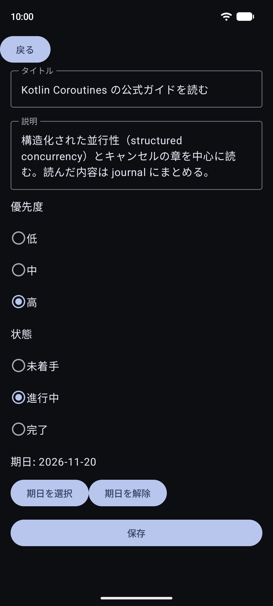
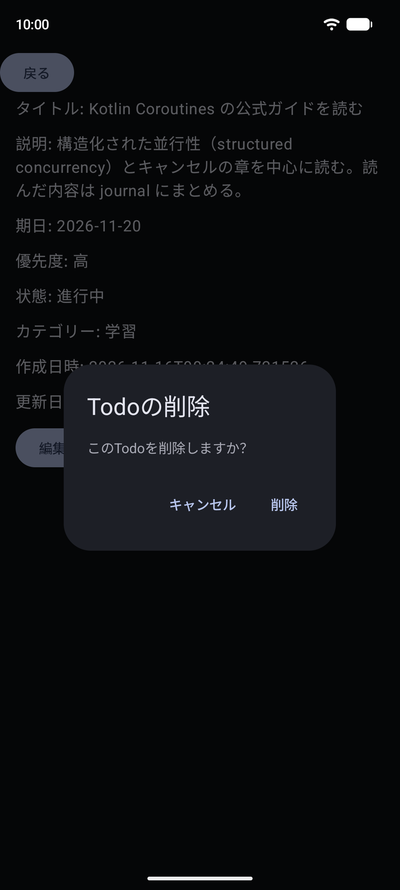
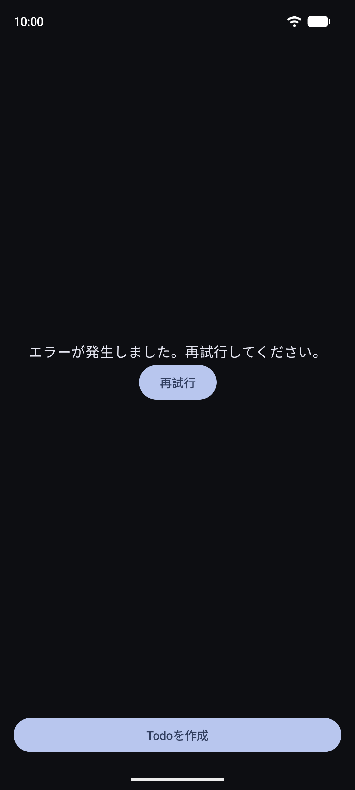
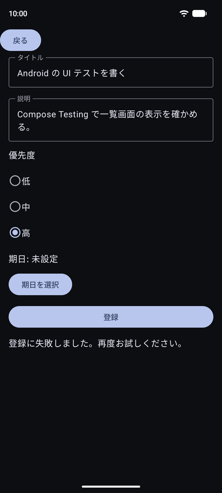
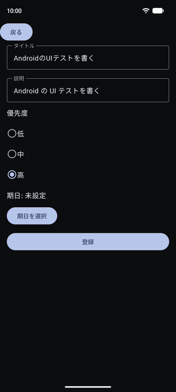
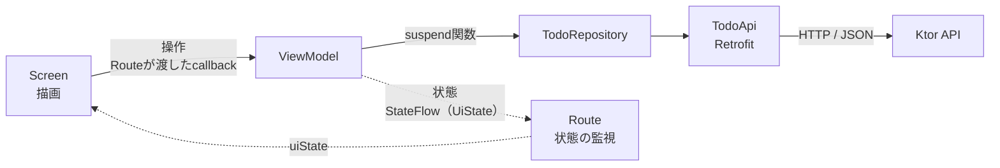

# KotlinTodo

Jetpack Composeで作ったTodo管理のAndroidアプリ。自作のKtor APIとPostgreSQLに接続し、Todoの一覧・詳細・登録・編集・削除を行う。

Kotlin / Androidの学習を目的とした個人開発であり、実務の成果物や公開中のサービスではない。機能の数より、実装したコードと設計判断を自分の言葉で説明できることを優先している。



| | |
|---|---|
| 主な対象 | Androidアプリ（[`android/`](android/)） |
| 補助 | Ktor API（[`backend/`](backend/)）。Androidから呼び出すTodo CRUD APIとして維持している |
| 開発体制 | 1人。実装コードは自分で書いている（[開発の進め方](#開発の進め方)） |
| 状態 | Todo CRUDと操作中の制御を実装済み。[既知の制約](#既知の制約と今後の課題)がある |

## 実装済みの機能

| 画面 | できること |
|---|---|
| 一覧 | APIから取得したTodoを表示する。読み込み中・0件・取得失敗を表示し分け、失敗時は再試行できる |
| 詳細 | 一覧で選んだTodoの内容（説明・期日・優先度・状態・カテゴリ・作成と更新の日時）を表示する。編集・削除へ進める |
| 登録 | タイトル・説明・期日・優先度を入力して登録する。失敗しても入力を残し、そのまま再送信できる |
| 編集 | タイトル・説明・期日・優先度・状態を変更する。失敗しても入力を残す。既存のカテゴリは保持する |
| 削除 | 詳細画面の確認ダイアログから削除する。失敗時は詳細を残して再操作できる |
| 共通 | 詳細・登録・編集の画面上部に戻るボタンを置く。送信中・削除中は進行表示を出し、入力・再送信・戻る操作を止める。成功はSnackbarで知らせ、戻り先の画面をAPIから再取得する |

次の機能は実装していない。カテゴリの選択・管理画面、認証、検索・並べ替え、オフライン対応。

## スクリーンショット

| 一覧 | 詳細 | 登録 | 編集 |
|---|---|---|---|
|  |  |  |  |

| 削除の確認 | 取得失敗と再試行 | 登録失敗後の入力保持 | 登録から一覧更新まで |
|---|---|---|---|
|  |  |  |  |

## Androidの技術構成

- Kotlin 2.2 / minSdk 26 / targetSdk 37
- Jetpack Compose + Material 3、Navigation Compose（型で定義した画面遷移）
- ViewModel + StateFlow + Coroutines
- Retrofit 3 + OkHttp + kotlinx.serialization
- JUnit 4 + kotlinx-coroutines-test
- 依存の組み立ては手動（[`MainActivity`](android/app/src/main/java/com/genkihashioka/kotlintodo/MainActivity.kt)）。DIライブラリは使っていない

1つの画面は、状態を監視する役（Route）、描画する役（Screen）、状態を持つ役（ViewModel）、状態の型（UiState）に分けている。操作と状態は別の経路を通る。



- 操作の経路（実線）：ScreenがViewModelの関数を呼び、ViewModelがRepository経由でAPIを呼ぶ
- 状態の経路（点線）：ViewModelが結果をStateFlowへ書き、Routeが監視してScreenへ渡す

画面遷移と画面間の更新通知は[`KotlinTodoNavHost`](android/app/src/main/java/com/genkihashioka/kotlintodo/ui/navigation/KotlinTodoNavHost.kt)が受け持つ。ViewModelは画面遷移の仕組みや他画面のViewModelを知らない。各要素の責務は[architecture.md](docs/architecture.md#androidクライアント)を参照。

## 設計判断と検証

| 判断 | 内容 | 根拠 |
|---|---|---|
| 画面の状態を型で分ける | 一覧は読み込み中・成功・0件・失敗を`sealed interface`で表す。描画側の`when`に`else`を書かず、状態を足したときの表示漏れをコンパイル時に検出する | [`TodoListUiState`](android/app/src/main/java/com/genkihashioka/kotlintodo/ui/todo/list/TodoListUiState.kt) |
| 失敗しても入力を残す | 入力値と送信中・失敗・完了を同じ状態に持つ。失敗では失敗フラグ（`hasSubmitError`）だけを立て、入力値には触れない。送信中の解除は`finally`で行い、再送信できる状態へ戻す | [`TodoCreateViewModel`](android/app/src/main/java/com/genkihashioka/kotlintodo/ui/todo/create/TodoCreateViewModel.kt) |
| 二重送信を2か所で止める | ボタンの無効化に加え、ViewModelでも送信中・完了済みの呼び出しを受け付けない | 同上、[Android 08のjournal](docs/journal/android/08-todo-submit-navigation.md) |
| 保存の成功と再取得の結果を分ける | 成功のSnackbarは保存APIの結果だけを表す。戻り先の再取得が失敗した場合は、その画面の失敗表示と再試行で扱う | [回帰テスト B09](docs/testing/android/todo-regression-results.md) |
| 更新通知をNavHostに集める | 保存に成功したら、NavHostが戻り先の画面へ「再取得が必要」と記録してから画面を戻す。更新後のデータを画面間で受け渡す方法や、共有キャッシュは採らなかった | [ADR 0023](docs/decisions/0023-navigation-refresh-notification.md) |
| 画面遷移の連打を画面遷移の定義で止める | 戻るボタンを素早く2回押すと、前の画面まで履歴から消えて画面が空になった。画面が操作を受け付けている間だけ処理を通す`dropUnlessResumed`で、NavHostの戻る処理を包んだ。画面側にフラグを持つ方法は、3画面に同じ仕組みが要るため採らなかった。画面を進む操作も、連打で同じ画面が2重に開いたため、同じ判定で止めた。`todoId`を受け取る処理は`dropUnlessResumed`で包めないため、その画面の`backStackEntry`で同じ判定を書いた | [Android 15](docs/journal/android/15-form-back-button.md)・[Android 17](docs/journal/android/17-forward-navigation-double-tap.md)のjournal |
| 通信全体に30秒の上限を設ける | 送信中は戻る操作を止めるため、応答が来ないと操作を再開できない。HTTPクライアントの呼び出し全体に上限を設け、既存の失敗処理へつなげた | [ADR 0024](docs/decisions/0024-http-call-timeout.md) |
| 通信の境界を差し替えてテストする | APIの呼び出し口（`TodoApi`）だけをテスト用の実装（`FakeTodoApi`）へ差し替え、ViewModelとRepositoryは本物を使う。応答を保留して、待っている間の状態と完了後の状態を別々に確認する | [`TodoListViewModelTest`](android/app/src/test/java/com/genkihashioka/kotlintodo/ui/todo/list/TodoListViewModelTest.kt) |

編集に成功した後の再取得は、画面ごとに時点が異なる。詳細は編集画面から戻った時点で再取得する。一覧は、その後に詳細から一覧へ戻った時点で再取得する。

設計判断の一覧は[ADR](docs/decisions/README.md)、機能ごとの設計と学びは[設計メモ](docs/design-notes/)と[journal](docs/journal/)に残している。

## テスト

| 種類 | 範囲 | 件数 | 記録 |
|---|---|---|---|
| Androidの単体テスト | 一覧ViewModelの初回取得（読み込み中・成功・0件・失敗）、再試行、再取得 | 6 | [実施結果](docs/testing/android/12-todo-list-viewmodel-tests.md) |
| Androidの単体テスト | タイトルの改行を空白へ置き換える関数 | 4 | [Android 13のjournal](docs/journal/android/13-todo-ui-usability.md) |
| Androidの手動回帰テスト | CRUD、入力の変換、操作中の制御、失敗後の復帰、成功通知、再取得の失敗（Pixel 8のエミュレーター） | 27ケース | [テスト設計](docs/test-plans/android/11-todo-regression-testing.md)、[実施記録](docs/testing/android/todo-regression-results.md) |
| Backendの自動テスト | Repository 5、Service 5（どちらもTestcontainersの実PostgreSQL）、OpenAPI仕様 4 | 14 | [architecture.md](docs/architecture.md#7-テスト戦略) |

自動テストにしていない範囲は次のとおり。手動回帰テストで確認したものを含むが、自動で検証したという意味ではない。

- Android：詳細・登録・編集のViewModel、ComposeのUI、画面遷移、実際のHTTP通信
- Backend：HTTP経由でルーティングからDBまでを通すテスト（入力検証とエラー応答は手動のcurlで確認）
- CI（GitHub Actionsなど）は未導入

## 既知の制約と今後の課題

- **結果が不明なときの整合回復がない。** 削除の応答を受け取れずタイムアウトすると、サーバーでは削除済みでも、アプリには削除失敗の表示と古い詳細が残る。手動回帰テストで再現して記録した（[C01](docs/testing/android/todo-regression-results.md)）
- **登録の再送信で重複する可能性がある。** 登録の応答だけを受け取れなかった場合、再送信すると同じTodoが2件できる。二重送信の防止は同時送信を止めるもので、この場合は防げない（[Android 05のjournal](docs/journal/android/05-todo-create.md)）
- 入力中の値はViewModelにだけ持つ。OSがプロセスを終了した後の入力の復元には対応していない
- 一覧APIは並び順を指定していないため、更新後の再取得で順序が変わることがある
- 認証は未実装で、固定の1ユーザーを使う（[ADR 0007](docs/decisions/0007-fixed-user-until-auth-exists.md)）。ローカルでの起動だけを想定している

進める順序は[roadmap.md](docs/roadmap.md)を参照。

## Backend

Androidから呼び出すTodo CRUD APIとして自作した。

- Kotlin 2.4 / JDK 25 / Ktor 3.5（Netty）
- Exposed 0.61（SQL DSL）/ PostgreSQL 17 / Flyway 11 / HikariCP 6
- 入力検証はKonform、エラー応答はStatusPagesで1つの形に統一
- OpenAPI仕様をルーティングのコードから生成し、Swagger UIで確認できる

構成は Routing → Service → Repository → DB の3層。Spring Boot + JPAで作ったものをKtor + Exposedへ移した経緯がある（[ADR 0008](docs/decisions/0008-migrate-from-spring-to-ktor.md)）。テストの拡充と機能追加は、Androidを優先するため保留している（[ADR 0022](docs/decisions/0022-prioritize-android-client.md)）。

## セットアップ

動作を確認しているのは、Windows 11でBackendをWSL2（Ubuntu）、AndroidをWindows側で動かす構成である。同じリポジトリを2か所へcloneして使っている。Windows版のGradleをWSLのファイルシステム上で実行するとファイルロックに失敗するため、分けている。

必要なもの：Docker、JDK 25（Backend）、Android StudioとAndroid Emulator。

### 1. Backendを起動する

```bash
docker compose up -d postgres
cd backend
./gradlew run
```

`http://localhost:8080`で待ち受ける。テーブルはFlywayが起動時に作成する。

```bash
curl http://localhost:8080/health
curl http://localhost:8080/todos
```

Swagger UIは<http://localhost:8080/swagger>、OpenAPI JSONは<http://localhost:8080/openapi.json>。

### 2. AndroidにAPIの接続先を設定する

接続先はビルド時に`kotlinTodoApiBaseUrl`というGradleプロパティから読み込む。**未設定、または末尾が`/`でない場合は、ビルドも単体テストも失敗する。**

Gradle User Homeの`gradle.properties`（Windowsでは`%USERPROFILE%\.gradle\gradle.properties`。無ければ作成する）へ次の行を加える。

```properties
kotlinTodoApiBaseUrl=http://<WSL2のIPアドレス>:8080/
```

WSL2のIPアドレスは次のコマンドで確認できる。IPアドレスが変わったら、この値を更新してビルドし直す。

```powershell
wsl -d Ubuntu -- hostname -I
```

設定した値は次のコマンドで確認できる。

```powershell
cd android
.\gradlew.bat properties --property kotlinTodoApiBaseUrl -q
```

BackendをEmulatorと同じOS上で動かす場合、Emulatorからは一般に`http://10.0.2.2:8080/`で接続できる。この構成は本リポジトリでは確認していない。

### 3. Androidアプリを起動する

`android/`をAndroid Studioで開き、Emulatorで実行する。暗号化していないHTTP通信はデバッグビルドでだけ許可している。

## テストの実行

Backend（Dockerが起動している必要がある）：

```bash
cd backend
./gradlew test
```

Android（Windows PowerShell）：

```powershell
cd android
.\gradlew.bat testDebugUnitTest
```

Androidの単体テストはBackend・DB・Emulatorへ接続しない。ただしビルドを伴うため、上記の`kotlinTodoApiBaseUrl`は設定しておく必要がある。テストでは接続先として使わないので、`http://localhost:8080/`のような値でよい。

## 開発の進め方

- 実装コードは自分で書いている。AI（Claude Code）には概念の説明と下書きの提示を、Codexには実装後のレビューを任せている。指摘を採用するかは自分で決める（[ADR 0026](docs/decisions/0026-claude-teaches-codex-reviews.md)）
- ドキュメント（ADR・設計メモ・journal・このREADME）はAIが下書きし、自分が事実と判断をレビューしている
- 機能ごとにIssueを立て、実装前に設計メモを書き、Pull Request経由でマージしている
- 記録では、自分が実行して確認したことと、AIがコードを読んで確認したことを区別している

## ドキュメント

| 文書 | 内容 |
|---|---|
| [requirements.md](docs/requirements.md) | 何を作るか |
| [architecture.md](docs/architecture.md) | 全体構成と各要素の責務 |
| [roadmap.md](docs/roadmap.md) | 進める順序と残課題 |
| [decisions/](docs/decisions/README.md) | 設計判断の記録（ADR） |
| [design-notes/](docs/design-notes/) | 実装前の設計メモ |
| [journal/](docs/journal/) | 実装後の学びと、設計との差分 |
| [test-plans/](docs/test-plans/README.md) / [testing/](docs/testing/README.md) | テストの設計と実施結果 |
