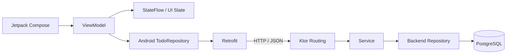
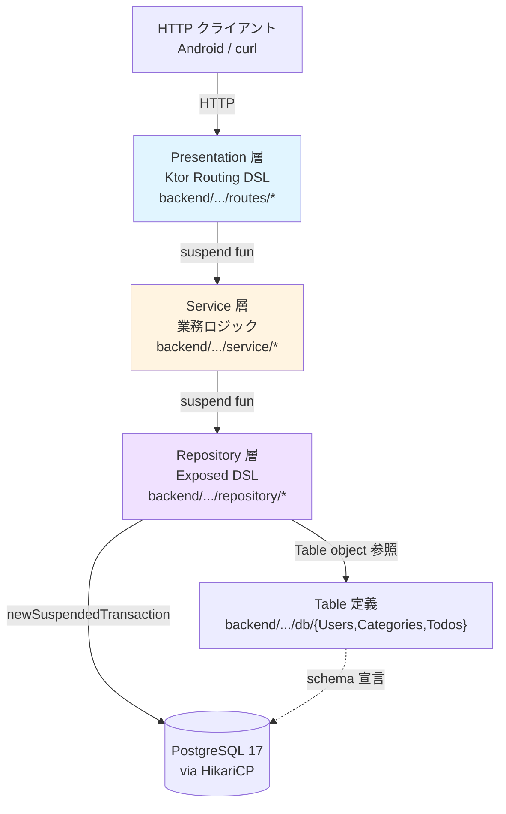
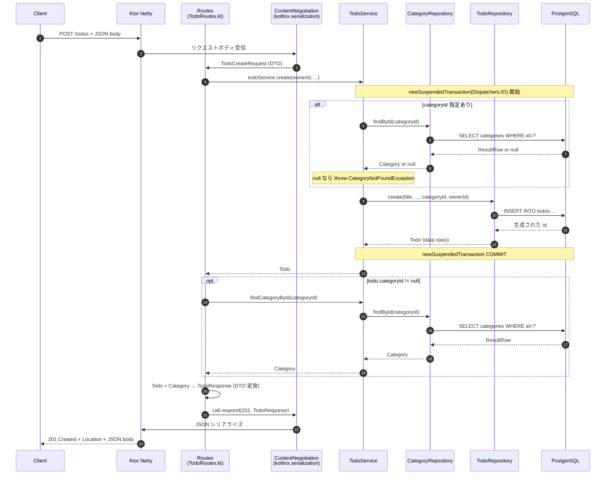
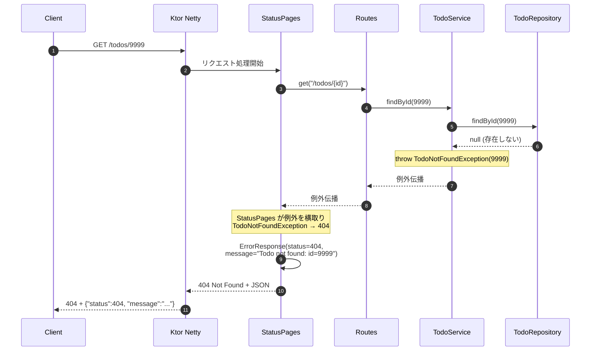

# アーキテクチャ設計

**バージョン**: 0.15（Android一覧ViewModelのローカル単体テスト）
**最終更新**: 2026-10-25

このドキュメントはkotlin-todoの**システム全体構成・レイヤー・依存・データフロー**の一次ソース。Androidクライアント、Ktorバックエンド、PostgreSQLを対象とする。「何を作るか」は[requirements.md](requirements.md)、実装順序は[roadmap.md](roadmap.md)、実装の詳細は[journal](journal/)と[design-notes](design-notes/)、テスト設計は[test-plans](test-plans/README.md)、実施結果は[testing](testing/README.md)、個別の設計判断は[decisions (ADR)](decisions/)を参照。

---

## 1. 技術スタック

### バックエンド

| レイヤー | 採用技術 | バージョン | 選定 ADR |
|---|---|---|---|
| Web フレームワーク | **Ktor** (server-netty) | 3.5.2 | [ADR 0008](decisions/0008-migrate-from-spring-to-ktor.md) |
| HTTP エンジン | **Netty** | 4.2.x（Ktor BOM 経由） | ADR 0008 |
| ORM / SQL ライブラリ | **Exposed** (DSL API) | 0.61.0 | [ADR 0015](decisions/0015-exposed-dsl-over-dao.md) |
| DB 接続プール | **HikariCP** | 6.2.1 | — |
| DB マイグレーション | **Flyway** | 11.1.0 | [ADR 0011](decisions/0011-flyway-for-schema-management.md) |
| データベース | **PostgreSQL** | 17 | [ADR 0010](decisions/0010-db-migration-before-framework-swap.md) |
| JSON シリアライズ | **kotlinx.serialization** | 1.11.0（Kotlin 2.4.10 の plugin 経由） | — |
| 依存注入 | **手動 DI** (Application.module() で組み立て) | — | [ADR 0014](decisions/0014-manual-di-over-koin.md) |
| ロギング | **Logback + SLF4J** | 1.5.16 | — |
| バリデーション | **Konform** | 0.11.1 | [ADR 0016](decisions/0016-konform-for-validation.md) |
| 例外→HTTP マッピング | **Ktor StatusPages** | 3.5.2（Ktor BOM 経由） | [ADR 0017](decisions/0017-error-response-and-exception-mapping.md) |
| API 仕様生成 | **Ktor OpenAPI**（コンパイラプラグイン + `ktor-server-routing-openapi` / `ktor-server-swagger`） | 3.5.2 | [ADR 0020](decisions/0020-generate-openapi-from-routing.md) |
| テスト | **JUnit 5 + kotlin-test + Testcontainers + ktor-server-test-host** | 5.x + 1.20.4 + 3.5.2 | [ADR 0012](decisions/0012-testcontainers-for-integration-test.md) / [ADR 0018](decisions/0018-pin-docker-api-version-for-testcontainers.md) |

### Android

| 項目 | 採用技術 | バージョン / 方針 |
|---|---|---|
| 言語 | Kotlin | 2.2.10 |
| UI | Jetpack Compose + Material 3 | Compose BOM 2026.02.01 |
| 状態管理 | ViewModel + StateFlow | Lifecycle 2.11.0 |
| 非同期処理 | Kotlin Coroutines | `viewModelScope`を使用 |
| HTTP Client | Retrofit + OkHttp | Retrofit 3.0.0 |
| JSON | kotlinx.serialization | 1.9.0 |
| DI | 手動DI | `MainActivity`で依存関係を組み立てる暫定構成 |
| 対応OS | Android | minSdk 26 / targetSdk 37 |

### 開発環境

| 項目 | 採用 | 備考 |
|---|---|---|
| ホスト OS | Windows 11 | — |
| 開発 OS | WSL2 (Ubuntu) + Windows | BackendはWSL2、AndroidはWindowsファイルシステム上で開発 |
| JDK | Amazon Corretto 25 (LTS) | SDKMAN 管理 |
| Kotlin | 2.4.10 | Ktor の OpenAPI 生成が 2.4.0 以上を要求（[ADR 0020](decisions/0020-generate-openapi-from-routing.md)） |
| IDE | IntelliJ IDEA CE / Android Studio | Backend / Androidで使い分ける |
| Gradle | 9.6.0, Kotlin DSL | [ADR 0013](decisions/0013-kotlin-dsl-gradle.md) / [ADR 0021](decisions/0021-pin-gradle-to-ide-tooling-api.md)（IDE 同梱の Tooling API に合わせて固定） |
| DB 起動 | Docker Compose | `docker compose up -d postgres` |

Linux版Android StudioをWSL2へ導入する構成も可能性としてはある。ただし現在はWindows上のAndroid Emulatorを使用するため、WSLg、ADB、GPU・仮想化をまたぐ環境も追加で扱うことになる。Androidの設計・実装へ学習範囲を集中し、実際に安定動作を確認できた構成を使うため、Android StudioとAndroidプロジェクトはWindows側、BackendとPostgreSQLはWSL2側に配置する。詳細な判断は[ADR 0022](decisions/0022-prioritize-android-client.md)を参照。

---

## 2. システム全体とレイヤー構成

AndroidクライアントがKtor APIをHTTP / JSONで呼び出し、KtorがPostgreSQLへアクセスする。



### Androidクライアント

現在のAndroidクライアントは、一覧・詳細・登録・編集の責務を分離している。編集機能はIssue #52で実装し、保存成功・失敗と送信中の入力制御を手動確認している。個別の確認範囲は[Android 06のjournal](journal/android/06-todo-edit.md)を参照。

| 要素 | 責務 |
|---|---|
| `MainActivity` | Androidのエントリポイント。RepositoryとViewModel Factoryを組み立て、Composeを開始する。共通Snackbarの状態・Scopeを保持して成功メッセージを表示する |
| `TodoListRoute` | ViewModelの`StateFlow`をライフサイクルに合わせて監視し、状態と再試行callbackをScreenへ渡す |
| `TodoListScreen` | 渡された`TodoListUiState`に応じてLoading / Success / Empty / Errorを描画する |
| `TodoListViewModel` | Repositoryへ取得を指示し、取得結果または例外を画面状態へ変換する |
| `TodoListUiState` | `sealed interface`でTodo一覧画面のLoading / Success / Empty / Errorを表す |
| Android `TodoRepository` | ViewModelとremote data sourceの境界。現在は`TodoApi`を委譲する |
| `TodoApi` | Retrofitの`GET /todos`、`GET /todos/{id}`、`POST /todos`、`PUT /todos/{id}`、`DELETE /todos/{id}`契約 |
| `ApiClient` | `BuildConfig`のベースURL、JSON converter、30秒のcallTimeoutを持つ共有OkHttpClientからRetrofitとTodoApiを生成する |
| `TodoDto`ほか | Ktor APIのJSONレスポンスに対応する通信境界のモデル |
| `KotlinTodoNavHost` / `TodoDestinations` | 型安全な画面定義、画面ごとのViewModel生成、遷移と戻り先への更新通知 |
| `TodoDetailRoute` / `TodoDetailScreen` | 詳細の状態監視、削除確認・進行・失敗表示、削除中の操作と戻る制御、削除操作・成功のcallback接続 |
| `TodoDetailViewModel` / `TodoDetailUiState` | Navigation引数のTodo IDによる取得・削除と状態更新。Successにtodoと削除中・失敗・削除済みを保持する |
| `TodoCreateRoute` | 入力callbackを接続し、`LaunchedEffect(isCreated)`から成功callbackを呼ぶ |
| `TodoCreateScreen` | 入力フォーム・送信中・失敗を表示し、送信中と登録済みの入力・追加送信・システムの戻る操作を制御する |
| `TodoCreateViewModel` / `TodoCreateUiState` | 入力値、送信中、失敗、登録済みの状態と登録処理を管理する |
| `TodoCreateRequest` | `POST /todos`のJSONリクエストを表す |
| `TodoEditRoute` | 編集callbackを接続し、`LaunchedEffect(isUpdated)`から成功callbackを呼ぶ |
| `TodoEditScreen` | 取得・入力・送信中・保存失敗を表示し、送信中と更新済みの入力・追加送信・システムの戻る操作を制御する |
| `TodoEditViewModel` / `TodoEditUiState` | IDから初期取得し、Loading / LoadError / Editing、入力と保存結果を管理する |
| `TodoEditViewModelFactory` | RepositoryとNavigationに対応したSavedStateHandleを渡す |
| `TodoUpdateRequest` | `PUT /todos/{id}`のJSONリクエストを表す |

状態は一方向に流す。

```text
ユーザー操作
    ↓
ComposeからViewModelの関数を呼ぶ
    ↓
ViewModelがRepositoryを呼ぶ
    ↓
ViewModelがMutableStateFlowを更新する
    ↓
Composeが読み取り専用StateFlowを監視して再描画する
```

Todo一覧画面の状態遷移は次のとおり。

```text
起動 / 再試行
    ↓
Loading
    ├─ 取得失敗 ─────→ Error
    └─ 取得成功
         ├─ 0件 ─────→ Empty
         └─ 1件以上 ─→ Success(todos)
```

`TodoListUiState`を`sealed interface`として定義し、Composeでは`when`を`else`なしで使用する。状態を追加したときに表示処理の不足をコンパイル時に検出できる。値を持たないLoading / Empty / Errorは`data object`、Todo一覧を持つSuccessは`data class`で表す。

ViewModelは通常の`Exception`をErrorへ変換する。一方、ViewModelの破棄などによる`CancellationException`は再スローし、Coroutineのキャンセルを妨げない。Error画面の再試行操作は、Screenから`onRetry` callbackとしてRouteへ渡り、RouteがViewModelの`retry()`を呼ぶ。

現時点では`TodoDto`をSuccessで直接使用する。表示用の変換要件が生じた時点で、API DTOとUIモデルを分離する。

### 画面遷移と登録後の一覧更新

`MainActivity`はRepositoryと各ViewModel Factoryを組み立てる。ViewModelは各Destination内で生成し、そのBackStackEntryに紐づける。一覧から詳細へはTodo IDを渡し、詳細ViewModelがAPIから取得する。

登録画面は入力値を保持したまま`isSubmitting`、`hasSubmitError`、`isCreated`を更新する。説明の空白入力はnull、任意の期日は`LocalDate?`から日付文字列へ変換する。ステータスは`NOT_STARTED`、categoryIdはnull。ViewModelのガードは送信中・登録済みの追加送信を拒否する。通常の例外は失敗状態へ変換し、CancellationExceptionは再スロー、finallyで送信中を解除する。

```text
POST /todos成功
  → isCreated = true
  → RouteのLaunchedEffectからonCreated()
  → NavHostが一覧のSavedStateHandleへtodo_list_refresh_required = trueを保存
  → popBackStack()で登録画面を取り除く
  → 一覧側がgetStateFlowとcollectAsStateWithLifecycleで通知を受け取る
  → LaunchedEffectから一覧ViewModelのrefresh()を呼び、通知をfalseへ戻す
  → APIの取得結果で一覧のStateFlowを更新し、Composeへ反映
```

戻るだけでは、保持された一覧ViewModelのinitは再実行されない。再コンポーズ自体もAPI取得を行わないため、明示的な再取得が必要となる。通知のfalseへの変更は要求を受け付けたことを表し、通信完了を表さない。再取得失敗は既存のError表示とretry()で扱う。retry()とrefresh()は同じloadTodos()に委譲し、呼ぶ目的を名前で区別する。

画面遷移と画面間の通知はNavHostが担当し、ViewModelにNavControllerや別画面のViewModelを渡さない。登録画面の入力状態のプロセス再生成対応、自動テスト、詳細な入力エラーやレイアウト改善は後続の課題とする。

### 編集と成功後の詳細・一覧更新

詳細から`TodoEditDestination(todoId)`へ進む。編集ViewModelがIDから取得し、成功時に一度だけEditingの初期値を設定する。API DTO全体をNavigation引数や編集状態として渡さず、入力項目と操作状態を分けて保持する。

更新は[ADR 0005](decisions/0005-update-uses-put-not-patch.md)のPUT契約に従う。タイトル、説明、期日、優先度、ステータス、categoryIdを送信内容に含め、説明の空白と期日の解除はnullへ変換する。カテゴリ選択UIは追加せず、取得時の`category?.id`を保持する。ステータスは既存値から編集し、選択の遷移順序は制限しない。

送信内容は保存開始時の入力から確定する。ViewModelは空白タイトル・送信中・更新済みの保存を拒否する。Screenも送信中・更新済みは入力と保存を無効にする。保存失敗では入力を保持し、finallyで送信中を解除して操作を再開する。CancellationExceptionは再スローする。

```text
PUT /todos/{id}成功
  → isUpdated = true
  → RouteのLaunchedEffectからonUpdated()
  → NavHostが直前の詳細へtodo_detail_refresh_required = trueを保存
  → Back Stackの一覧へtodo_list_refresh_required = trueを保存
  → popBackStack()で編集画面を取り除く
  → 各画面が通知を受け付け、refresh()を開始して通知をfalseへ戻す
  → APIの取得結果で各ViewModelのStateFlowを更新し、表示へ反映
```

一覧・詳細・編集の経路を前提とし、一覧のBackStackEntryを明示的に取得する。通知は通信完了を待たずに消費し、再取得失敗は各画面の既存のError表示とretry()で扱う。設計理由と代替案は[ADR 0023](decisions/0023-navigation-refresh-notification.md)へ記録する。保存せず戻る場合は更新リクエストと通知を送らない。ただし、送信後に画面を破棄してもBackendでの保存を取り消せる保証はない。

入力のプロセス再生成対応、競合更新の検出、自動テスト、レイアウト・タップ範囲、一覧の並び順は後続課題とする。

### 操作成功のSnackbar表示

MainActivityの共通ScaffoldにSnackbarHostを配置し、SnackbarHostStateをrememberで保持する。表示用のrememberCoroutineScopeもこの共通部分で取得するため、NavHost内の画面遷移後も表示を継続できる。

NavHostは既存の再取得通知を保存し、popBackStackが成功した場合にonTodoCreated / onTodoUpdated / onTodoDeletedを呼ぶ。MainActivityがstrings.xmlから取得した文言を、launch内のshowSnackbarで表示する。アクションなし・既定の短時間表示とし、同じHostへの連続した表示依頼は順番に処理される。表示終了を待ってから画面を戻す構成にはしない。

成功通知はAPI操作の結果を表し、再取得完了とは区別する。再取得用BooleanをSnackbarの契機には使わない。Route・ViewModel・UiState・Repositoryの責務は維持し、Snackbar専用の状態を追加しない。画面再訪だけでは再表示せず、Activity再作成やプロセス再生成後の通知復元は保証しない。共通Hostのため、表示中に別画面へ移動しても通知が続き得る。設計理由と確認範囲は[設計メモ](design-notes/android/09-todo-success-feedback.md)と[journal](journal/android/09-todo-success-feedback.md)を参照。

### 登録・編集の保存中の戻る制御

各Screenは既存のUiStateから戻る操作の可否を計算する。登録はisSubmittingもisCreatedもfalseの場合に許可する。編集はLoading / LoadErrorで許可し、EditingではisSubmittingもisUpdatedもfalseの場合に許可する。可否はローカルのvalとし、状態の変更を受けた再コンポーズで計算し直す。新しい状態フラグは追加しない。

各ScreenのBackHandlerは、戻れない状態だけ有効にして操作を消費し、通常時はNavigationへ任せる。登録・編集に画面上の戻るボタンは新設していない。成功後のRouteのcallbackとNavHostのpopBackStack・再取得通知は既存のままで、自動遷移は妨げない。

両画面はisSubmittingがtrueの間、共通の「送信中…」を表示する。登録フォームのタイトル・説明・優先度・期日の選択と解除も、送信中と登録済みには無効にする。送信ボタンは空白タイトル・送信中・登録済みで無効とする。保存失敗では入力を保持し、既存のfinallyによる送信中の解除で操作を再開する。編集の入力制御とViewModelの送信ガードは維持する。詳細は[Android 08のjournal](journal/android/08-todo-submit-navigation.md)を参照。

### 詳細からの削除と待機中の操作制御

削除は詳細のSuccess内に置き、確認ダイアログで承認後に開始する。ダイアログ開閉はScreen内のrememberで保持する。キャンセル・dismissは閉じるだけでAPIを呼ばない。DELETEは[ADR 0006](decisions/0006-delete-returns-200-with-body.md)に従いTodoDtoを返し、ViewModelは正常終了を成功として扱う。

Successはtodoに加えてisDeleting、hasDeleteError、isDeletedを持つ。削除開始前にSuccess・削除中・削除済みを確認し、launch前に削除中へ更新する。失敗時もSuccessの詳細を保持し、通常の例外でhasDeleteErrorを更新、CancellationExceptionは再スロー、finallyでisDeletingを解除する。

Screenは削除中と削除済みの編集・削除ボタンを無効にする。canGoBackはSuccess以外ならtrue、SuccessならisDeletingもisDeletedもfalseの場合にtrueとする。画面上の戻るボタンにはcanGoBackを渡し、BackHandler(enabled = !canGoBack)は戻る操作を受け取って画面を戻さない。成功後のNavHostによるpopBackStackは妨げない。削除中には「削除中…」を表示する。

削除成功はRouteのLaunchedEffectからonDeletedでNavHostへ通知する。直前の一覧のSavedStateHandleへtodo_list_refresh_requiredを保存して詳細を閉じ、一覧がAPIから再取得する。詳細は再取得しない。通知方針は[ADR 0023](decisions/0023-navigation-refresh-notification.md)を使う。

### HTTP呼び出しの制限時間と制約

ApiClientは共有OkHttpClientにcallTimeout(30, TimeUnit.SECONDS)を設定し、Retrofitへclientとして渡す。宣言順はOkHttpClient、Retrofit、TodoApiとする。設定は削除だけでなく一覧・詳細取得、登録・編集にも適用される。接続・読み書きの既定のタイムアウトは変更しておらず、常に30秒待つという意味ではない。判断は[ADR 0024](decisions/0024-http-call-timeout.md)を参照。

HTTPタイムアウトは既存の例外処理で失敗表示と操作復帰につなげる。通信を打ち切ってもBackendの処理完了を取り消す保証はない。検証ではタイムアウト後に削除が完了し、古い詳細からの編集・更新が失敗することも確認された。結果不明時の再取得・整合回復、削除失敗を断定する現在の文言の見直しは後続課題とする。登録・編集・削除の戻る制御は画面操作による離脱への対策であり、プロセス終了や通信断への対応ではない。

現在のAndroidモジュールと主要パッケージは次の構成。

```text
android/
└── app/
    └── src/main/java/com/genkihashioka/kotlintodo/
        ├── MainActivity.kt
        ├── data/
        │   ├── remote/
        │   │   ├── ApiClient.kt
        │   │   ├── api/TodoApi.kt
        │   │   └── model/{TodoDto,TodoCreateRequest,TodoUpdateRequest,CategoryDto,Priority,TodoStatus}.kt
        │   └── repository/TodoRepository.kt
        └── ui/
            ├── navigation/{KotlinTodoNavHost,TodoDestinations}.kt
            ├── todo/
            │   ├── list/TodoList{Route,Screen,UiState,ViewModel,ViewModelFactory}.kt
            │   ├── detail/TodoDetail{Route,Screen,UiState,ViewModel,ViewModelFactory}.kt
            │   ├── create/TodoCreate{Route,Screen,UiState,ViewModel,ViewModelFactory}.kt
            │   └── edit/TodoEdit{Route,Screen,UiState,ViewModel,ViewModelFactory}.kt
            └── theme/
```

`ui/todo`はlist / detail / create / editに分け、各画面のRoute・Screen・UiState・ViewModel・Factoryを5ファイルずつまとめる。削除は詳細の操作としてdetailに含める。1画面の変更で関連ファイルを追いやすくするための配置であり、既存のUI・Repository・通信境界の責務と依存関係は維持する。Navigationとテーマは共通の配置に残す。種類別との比較と採用理由は[ADR 0025](decisions/0025-screen-based-todo-ui-packages.md)、実施結果と確認範囲は[Android 10のjournal](journal/android/10-todo-ui-packages.md)を参照。

`app`は現在唯一のAndroid application moduleである。機能が少ない段階ではmoduleを分割せず、各packageの責務が大きくなり、分割で解決できる具体的な問題が生じた時点で再検討する。

### Backend

Todo API は 3 層 + DB の構成。全てのリクエストは **上→下** の方向にのみ依存が流れる（依存の逆流なし）。



**この図が描いているのは「実行時に誰が誰を呼ぶか」であり、ディレクトリの一覧ではない。** ノードになっているのは処理を実行する側（`routes/`, `service/`, `repository/`, `db/`）だけで、**層の間を運ばれるデータ定義（`dto/`, `domain/`）、投げられて捕まる例外（`exception/`）、routes から呼ばれるだけの検証ルール（`validation/`）はノードにならない**。図に出てこないディレクトリがどの層に属するかは [図に現れないディレクトリの位置づけ](#図に現れないディレクトリの位置づけ) にまとめる。

### 各層の責務

**Presentation 層（Ktor Routing）**
- HTTP リクエストの受付、パス / メソッドのルーティング
- リクエストボディの DTO へのデシリアライズ（kotlinx.serialization）
- レスポンス DTO のシリアライズ + HTTP ステータス設定
- 例外の StatusPages 経由での HTTP 変換（(b) で `TodoNotFoundException` / `CategoryNotFoundException`、(c) で `ValidationException` / `BadRequestException` / `Throwable` を追加）
- パスパラメータの形式検証（`id` が数値か）と 400 応答
- **リクエストボディの検証**（Konform。Service を呼ぶ前に実行する。[ADR 0016](decisions/0016-konform-for-validation.md)）
- **業務ロジックは書かない**（Service に委譲）
- **ファイル**:
  - `backend/src/main/kotlin/com/example/kotlin_todo/routes/*.kt` — ルーティング関数
  - `backend/src/main/kotlin/com/example/kotlin_todo/dto/*.kt` — リクエスト / レスポンスの形（**Presentation 層に属する**）
  - `backend/src/main/kotlin/com/example/kotlin_todo/validation/*.kt` — 検証ルール（**Presentation 層に属する**）

**Service 層（業務ロジック）**
- 複数 Repository を組み合わせる業務ルール（Category 存在確認 → Todo 作成など）
- カスタム例外の投出（`TodoNotFoundException`, `CategoryNotFoundException`）
- トランザクション境界の管理（複数 Repository 呼び出しを 1 トランザクションに束ねる）
- ADR 0006 の実装（delete が削除内容を返す）
- **HTTP に依存しない**（`ktor.*` を import しない）
- **ファイル**: `backend/src/main/kotlin/com/example/kotlin_todo/service/*.kt`

**Repository 層（データアクセス）**
- Exposed DSL による SQL 発行（`.insert`, `.selectAll().where`, `.update`, `.deleteWhere`）
- `ResultRow` → ドメイン data class への変換（`.toXxx()` 拡張関数）
- Enum ↔ String の境界変換（ADR 0001）
- `suspend fun` + `newSuspendedTransaction(Dispatchers.IO)` パターン
- **業務ルールは書かない**（Service 層の責務）
- **ファイル**: `backend/src/main/kotlin/com/example/kotlin_todo/repository/*.kt`

**Table 定義層（schema 宣言）**
- Exposed の `object Users : Table("users")` パターン
- `V1__init.sql` と 1:1 対応する schema 宣言（Exposed が DDL を発行するわけではない、schema の見方を Exposed に教える宣言）
- FK 関係、複合 UNIQUE、インデックスの宣言
- **ファイル**: `backend/src/main/kotlin/com/example/kotlin_todo/db/*.kt`

### 図に現れないディレクトリの位置づけ

全ディレクトリと所属レイヤーの対応。**「図に無い = 層が無い」ではない**点に注意。

| ディレクトリ | 所属レイヤー | 図のノード | 理由 |
|---|---|---|---|
| `routes/` | Presentation | ○ | HTTP を受けて Service を呼ぶ「実行主体」 |
| `dto/` | **Presentation** | × | HTTP 境界でやり取りする**データの形**。自分では何も呼ばない |
| `validation/` | **Presentation** | × | routes から呼ばれる検証ルール。他の層を呼ばない |
| `service/` | Service | ○ | 実行主体 |
| `repository/` | Repository | ○ | 実行主体 |
| `db/` | Table 定義 | ○ | schema 宣言 + 接続初期化 |
| `domain/` | **レイヤー横断** | × | 全層を貫いて運ばれる値オブジェクト |
| `exception/` | **レイヤー横断** | × | Service が投げ、Presentation が捕まえる。層をまたぐ通信手段 |
| `dev/` | **層の外（暫定）** | × | 開発用データ投入。認証実装時に削除する（Issue #23） |
| `Application.kt` | **組み立て役** | × | 全層のインスタンスを生成して繋ぐ composition root（[ADR 0014](decisions/0014-manual-di-over-koin.md)） |

**判定基準はひとつ**: そのコードが**能動的に他の層を呼び出すか**。呼び出すならノードになり、呼ばれも呼びもせず「運ばれるだけ」ならノードにならない。

#### `dto/`（Presentation 層）

- `backend/src/main/kotlin/com/example/kotlin_todo/dto/*.kt`
- **直下** — 特定のエンドポイントの表現: `TodoCreateRequest`, `TodoUpdateRequest`, `TodoResponse`, `CategorySummary`
- **サブパッケージ** — 横断的な仕組み:
  - `dto/error/` — `ErrorResponse`, `FieldError`。どのエンドポイントからも出るうえ、routes ではなく StatusPages が生成する（[ADR 0017](decisions/0017-error-response-and-exception-mapping.md)）
  - `dto/serializer/` — `java.time` 型用の `KSerializer` 実装（`LocalDateSerializer`, `LocalDateTimeSerializer`）
- `@Serializable` を付けた data class + `domain` ↔ `dto` の変換拡張関数（`Todo.toResponse()` など）
- **`dto/` は「データの形」だけを持ち、検証ルールは持たない**（ルールは `validation/`）
- **Service / Repository は `dto` を import しない**。DTO が下の層に漏れると「HTTP の都合が業務ロジックを侵食する」ため

#### `validation/`（Presentation 層）

- `backend/src/main/kotlin/com/example/kotlin_todo/validation/*.kt`
- `TodoValidation.kt` — Konform の `Validation<T>` 定義と `validateOrThrow()` 拡張関数
- `ValidationException.kt` — `List<FieldError>` を運ぶ `RuntimeException`
- **パッケージ外に公開するのは `validateOrThrow()` だけ**。`Validation` / `ValidationResult` / `FieldError` への変換はすべて `private`
- **`io.konform.*` の import はこのパッケージにしか現れない**。ライブラリを差し替えるとき書き換える範囲がここに閉じる
- 検証するのは**入力の形**（空でないか、長さ、符号）のみ。参照先が存在するかは Service 層の責務

#### `domain/`（レイヤー横断）

- `backend/src/main/kotlin/com/example/kotlin_todo/domain/*.kt`
- `data class User`, `Category`, `Todo` および `enum class Priority`, `TodoStatus`
- **全レイヤーで使う共通の値オブジェクト**
- **Exposed 依存無し**（`Table` を import しない、純粋な Kotlin data class）
- Service が返す型、Repository が返す型、Routing が受け取る型のすべて

#### `exception/`（レイヤー横断）

- `backend/src/main/kotlin/com/example/kotlin_todo/exception/*.kt`
- `TodoNotFoundException`, `CategoryNotFoundException`（いずれも `RuntimeException` 継承）
- **Service 層が投げ、Presentation 層の StatusPages が HTTP ステータスに変換する**
- Ktor 標準の例外（`BadRequestException` など）は Ktor エンジンが既定でステータスに変換するが、**自作例外は StatusPages に登録しない限り 500 になる**
- **`ValidationException` はここに置かない**。上記 2 つがドメインの例外であるのに対し、`ValidationException` は HTTP 境界の都合で生まれる Presentation 層の例外なので `validation/` に置く

---

## 3. モジュール構成（パッケージ構造）

```
backend/src/main/kotlin/com/example/kotlin_todo/
├── Application.kt          # エントリポイント (fun main, Application.module())
│                           # embeddedServer + Ktor プラグイン install + routing 組み立て
│
├── db/                     # DB 関連
│   ├── DatabaseFactory.kt  # HikariCP → Flyway.migrate() → Database.connect() の 3 段初期化
│   ├── Users.kt            # object Users : Table("users")
│   ├── Categories.kt       # object Categories : Table("categories")
│   └── Todos.kt            # object Todos : Table("todos")
│
├── domain/                 # ドメインクラス (Exposed 依存無し)
│   ├── User.kt             # data class User
│   ├── Category.kt         # data class Category
│   ├── Todo.kt             # data class Todo
│   ├── Priority.kt         # enum class Priority
│   └── TodoStatus.kt       # enum class TodoStatus
│
├── repository/             # Repository (手書きクラス、DSL API 使用)
│   ├── UserRepository.kt
│   ├── CategoryRepository.kt
│   └── TodoRepository.kt
│
├── service/                # Service (業務ロジック)
│   └── TodoService.kt
│
├── exception/              # カスタム例外 (RuntimeException 継承)
│   ├── TodoNotFoundException.kt
│   └── CategoryNotFoundException.kt
│
├── dto/                    # DTO (Presentation 層。HTTP 境界のデータの形)
│   ├── TodoCreateRequest.kt    # 作成リクエストボディ
│   ├── TodoUpdateRequest.kt    # 更新リクエストボディ
│   ├── TodoResponse.kt         # レスポンスボディ + Todo.toResponse()
│   ├── CategorySummary.kt      # TodoResponse に入れ子で載せる Category + Category.toSummary()
│   ├── error/                  # 横断的なエラーレスポンス (StatusPages が生成)
│   │   ├── ErrorResponse.kt    # status / message / fieldErrors
│   │   └── FieldError.kt       # field / message
│   └── serializer/             # java.time 型の KSerializer 実装
│       ├── LocalDateSerializer.kt
│       └── LocalDateTimeSerializer.kt
│
├── validation/             # 入力検証 (Presentation 層。Konform 依存はここに閉じる)
│   ├── TodoValidation.kt       # Validation<T> 定義 + validateOrThrow()
│   └── ValidationException.kt  # List<FieldError> を運ぶ RuntimeException
│
├── routes/                 # Ktor Routing 関数 (Presentation 層)
│   └── TodoRoutes.kt       # Route.todoRoutes() — /todos の CRUD 5 エンドポイント
│
└── dev/                    # 開発用の暫定コード (認証実装時に削除: Issue #23)
    └── DevDataInitializer.kt   # ownerId 用の固定ユーザーを冪等に用意する

backend/src/main/resources/
├── logback.xml             # ログ設定
└── db/migration/
    └── V1__init.sql        # Flyway 初期スキーマ

backend/src/test/kotlin/com/example/kotlin_todo/
├── AbstractPostgresTest.kt # Testcontainer 起動 + DatabaseFactory.init(...) の共通基底
├── repository/
│   ├── UserRepositoryTest.kt
│   └── TodoRepositoryTest.kt
└── service/
    └── TodoServiceTest.kt
```

### パッケージ命名の方針

- **snake_case は使わない**（Kotlin の慣習に反する）→ `com.example.kotlin_todo` のような **アンダースコア混じりは初期テンプレートの名残**、新規パッケージは `db`, `domain`, `service` などのフラットな camelCase
- **layer 名を第 1 セグメント**にする（`domain.Todo` ではなく `domain/Todo.kt`）
- **1 ファイル 1 主要クラス**（拡張関数など補助は同ファイル内で OK）

---

## 4. データフロー（HTTP リクエスト → レスポンス）

**例: `POST /todos` （Todo 作成）** のリクエスト処理シーケンス（Phase 4.9 (b) で実装済み）。



**要点**:

- **Routing は業務判断をしない**: 受け取った DTO の値をそのまま Service に渡すだけ
- **Service で 1 トランザクション**: 複数 Repository 呼び出し（Category 存在確認 + Todo 作成）が 1 つのトランザクションに束ねられる → check-and-act の原子性
- **Repository の内側 `newSuspendedTransaction` は外側を再利用**（Exposed の nested transaction 挙動）
- **Suspend chain**: HTTP ハンドラ → Service → Repository → DB クエリ、すべて `suspend`。DB 待ちの間 Netty のスレッドは他のリクエストに使い回される
- **`TodoResponse` 組み立てのための Category 取得は トランザクションの外**: Service が返した `Todo` を受けてから Routing が改めて `findCategoryById` を呼ぶため、Category の SELECT は別トランザクションになる。一覧取得 `GET /todos` では Todo の件数分この SELECT が発行される（**N+1 問題** / [#3](https://github.com/GenkiHashioka/kotlin-todo/issues/3)、Phase 5 で JOIN 化して解消予定）

---

## 5. エラー処理フロー

例外がどの層で発生し、どう伝播し、最終的にどう HTTP レスポンスに変換されるか。以下のシーケンス（`TodoNotFoundException` → 404）は Phase 4.9 (b) で実装済み。



### 例外のカテゴリと HTTP 対応

| 例外の種類 | どこで発生 | HTTP ステータス | `message` | `fieldErrors` | ログ | 実装 |
|---|---|---|---|---|---|---|
| `TodoNotFoundException` | Service (findById, update, delete) | 404 | `cause.message`（例: `Todo not found: id=42`） | 空 | 出さない | (b) 済 |
| `CategoryNotFoundException` | Service (create, update) | 404 | 同上 | 空 | 出さない | (b) 済 |
| `ValidationException` | Routes（`validateOrThrow()`） | 400 | `Validation failed` | Konform のエラー | 出さない | (c) 済 |
| `BadRequestException`（必須項目の欠落） | ContentNegotiation | 400 | `Validation failed` | 欠落フィールド名 | `warn` | (c) 済 |
| `BadRequestException`（enum 不一致 / 日付形式 / JSON 破損） | ContentNegotiation | 400 | `Malformed request body` | 空 | `warn` | (c) 済 |
| その他予期しない `Throwable` | 任意の層 | 500 | `Internal server error` | 空 | `error` | (c) 済 |

**すべてのエラーが `ErrorResponse(status, message, fieldErrors)` の形で返る。** クライアントはステータスコードごとに別の形を想定しなくてよい。

**ログのレベルは「誰が対処すべき問題か」で分けている。** 検証エラーはクライアントが直せばよい正常動作なので出さず（`install(CallLogging)` が 400 を返した事実は記録する）、返す情報を削った `BadRequestException` は `warn`、サーバ側の想定外は `error`。全部 `error` にすると入力ミスとバグがログ上で区別できなくなる。

**例外の message をクライアントに流すのは、自作例外のときだけ。** `TodoNotFoundException` の message は我々が書いたものだが、kotlinx や JDBC の例外には内部のパッケージ名・DB ホスト名・ライブラリ名が含まれる。詳細は [ADR 0017](decisions/0017-error-response-and-exception-mapping.md)。

**HTTP ステータスへの変換には 2 系統ある**（Phase 4.9 (b) の検証で判明）。

1. **StatusPages**（`Application.module()` で登録） — 自作例外はここに登録しない限り 500 になる
2. **Ktor エンジン既定**（`io.ktor.server.engine.defaultExceptionStatusCode`） — `BadRequestException` / `NotFoundException` / `UnsupportedMediaTypeException` / `PayloadTooLargeException` / `TimeoutException` を、何も書かなくてもステータスに変換する。ただし `call.respond(statusCode)` を呼ぶだけなので**レスポンスボディは空**

`call.receive<T>()` のデシリアライズ失敗は、ContentNegotiation が `catch (cause: Throwable) { throw BadRequestException(...) }` で包み直すため 2 の経路に乗る。**つまり不正な JSON は (b) 時点で既に 400 を返しており、(c) の課題は「ステータスを直すこと」ではなく「空のボディを `ErrorResponse` で埋めること」だった**。

(c) で `BadRequestException` と `Throwable` を StatusPages に登録したことにより、**現在は 2 の経路にレスポンスが落ちることはない**（登録した型が優先される）。

**StatusPages のハンドラ選択は登録順ではなく「クラス階層上の近さ」で決まる。** `exception<Throwable>` を登録しても `TodoNotFoundException` は 404 のハンドラに行く。実装は `findHandlerByValue` が候補を集め、複数あれば `selectNearestParentClass` で最も近い親クラスを選ぶ。

**デシリアライズ例外の包みは 2 段**。`MissingFieldException` を取り出すには連鎖を辿る必要があり、段数を直接書くと Ktor の実装変更で静かに壊れるため `generateSequence` で探索している。

```
BadRequestException            ← RequestConverter.kt:69
  └─ JsonConvertException      ← KotlinxSerializationConverter.kt:79
       └─ MissingFieldException など（kotlinx 本体）
```

**サブフェーズ分割の基準**: (b) 完了時点で「CRUD が正しく動く API」、(c) 完了時点で「不正な入力に正しく応答する API」になるよう分けた。リソース不在（404）は CRUD の正しさの一部とみなして (b) に含め、入力検証（400 系）を (c) にまとめた。

**`ErrorResponse` の段階的な拡張**: (b) では `status` + `message` の 2 フィールド。(c) で `fieldErrors: List<FieldError> = emptyList()` を**デフォルト値付きで**追加した。既存の生成箇所 3 つを一切変更せずに拡張でき、Ktor の `DefaultJson` が `encodeDefaults = true` を設定しているため空配列も JSON に出力される。

**例外ではない 400**: パスパラメータが数値でない場合（例: `GET /todos/abc`）は例外ではなく読み取り失敗のため、StatusPages ではなく Routes 層の分岐（`toLongOrNull() ?: 400`）で処理する。(b) で実装済み。この経路は上記 2 系統のどちらも通らず、ハンドラ内で `ErrorResponse` を明示的に返すため**ボディが入る**。

### 例外設計の方針

- **カスタム例外は `RuntimeException` 継承**（unchecked）: 呼び出し側で try/catch を強制しない → StatusPages が横取りする設計
- **例外オブジェクトに情報を含める**: `val id: Long` などのプロパティで「何が起きたか」を StatusPages が抽出できる
- **メッセージは日本語ではなく英語**: ログ・スタックトレースで読みやすさ優先。多言語対応 / エラーコード化はフロントエンド着手時に判断する（[#5](https://github.com/GenkiHashioka/kotlin-todo/issues/5)）
- **例外を throw する層 = Service**: Repository は null を返す、Service で「null → 例外」変換（Elvis 演算子 `?:`）。ただし `ValidationException` だけは Presentation 層（`validation/`）が投げる
- **例外の message を無検査でクライアントに返さない**: 自作例外は内容を制御できるので流用してよいが、ライブラリ由来の例外は内部情報を含む。固定文字列を返し、実物はログへ

---

## 6. トランザクション境界

Exposed の transaction 挙動と、本プロジェクトでの使い分け。

### `newSuspendedTransaction` の nested 挙動

- 外側でトランザクションが開いていれば、内側の `newSuspendedTransaction` は **外側を再利用**（新しい BEGIN しない）
- 外側が無ければ、内側で新規 BEGIN
- COMMIT / ROLLBACK は **最も外側のブロックが終了する時**に発生

### 各層でのトランザクション wrap 方針

| 層 | 単一 Repository 呼び出し | 複数 Repository 呼び出し |
|---|---|---|
| Routing | wrap しない（Service に委譲） | 同左 |
| Service | wrap しない（Repository の内側 wrap で完結） | **`newSuspendedTransaction(Dispatchers.IO)` で wrap** |
| Repository | **メソッド内部で常に wrap**（`newSuspendedTransaction(Dispatchers.IO) { ... }`） | — |

### なぜ Repository は必ず wrap するか

- Repository を Service なしで直接呼ぶケース（テスト、Application.module() の初期化ブロック）でも動くように
- 冗長な wrap でも Exposed が外側を再利用するので実害なし
- 「Repository は常に単独で動く」保証を設計として持つ

### なぜ Service で複数 Repository 呼び出しを wrap するか

- **check-and-act の原子性**: 「Category 存在確認 → Todo 作成」の間に Category が削除される TOCTOU 回避
- Repository の内側 wrap は外側 Service の transaction に合流するので、全体で 1 トランザクション

---

## 7. テスト戦略

### Android

Issue #62で機能横断の手動回帰テストを実施した。CRUD・入力変換・操作制御・失敗後の復帰・成功通知・再取得失敗を確認し、タイムアウト時にDBでは削除済みでも古い詳細が残る制約を観察した。結果不明時の整合回復は未対応である。

Loadingや処理中の確認にはRepositoryのAPI呼び出し前の一時待機を使った。操作成功後の再取得失敗には1回だけ取得例外を投げる仕掛けを使い、実HTTP障害とは区別した。結果不明の確認ではBackendの削除完了後に応答を遅らせた。検証用コードはすべて除去し、通常構成で登録・編集・削除を再確認した。本番コードの変更はない。

実行確認は開発者の報告、Codexは差分と文書の静的確認である。手動確認範囲と未検証事項は[実施記録](testing/android/todo-regression-results.md)、学びと設計との差分は[journal](journal/android/11-todo-regression-testing.md)を参照する。

一覧ViewModelの初回取得（Loading / Success / Empty / Error）とretry / refreshを、テスト用TodoApiと既存Repositoryを経由するローカル単体テスト6件で検証した。JUnit 4.13.2とkotlinx-coroutines-test 1.9.0を使用し、`src/test`だけにFakeを配置する。本番コードとAPI契約は変更していない。

ViewModel生成前にMainをStandardTestDispatcherへ差し替え、runTestと同じschedulerで進行を制御する。CompletableDeferredで応答を保留し、取得中の状態と完了後のデータを確認する。各テストのfinallyでviewModelScopeをキャンセルし、@AfterでMainを復元する。

対象クラス6件とtestDebugUnitTest全体の成功は開発者の報告、Codexは静的レビューと生成済みJUnit XMLの集計確認を行った。[実装設計](design-notes/android/12-todo-list-viewmodel-tests.md)、[テスト設計](test-plans/android/12-todo-list-viewmodel-tests.md)、[実施結果](testing/android/12-todo-list-viewmodel-tests.md)、[journal](journal/android/12-todo-list-viewmodel-tests.md)を参照。画面遷移・Snackbar・HTTP契約や他画面まで自動検証したとは扱わない。

### Backendの現状（Phase 4.10 完了時点）

- **Repository テスト** (5): 実 PostgreSQL に対して CRUD の挙動確認、FK CASCADE / SET NULL の動作確認
- **Service テスト** (5): 業務ロジック（例外投出、複数 Repository の組み合わせ）を実 PostgreSQL 上で確認
- **OpenAPI 仕様のテスト** (4): 生成された仕様書の中身（エンドポイントの一覧、エラーレスポンスの型、リクエストボディの型）を検証する。`testApplication` でルーティングだけを組み立てるため **DB に接続しない**（[ADR 0020](decisions/0020-generate-openapi-from-routing.md) 判断 8）
- **Ktor テスト（HTTP 経由で実際にリクエストを処理するもの）**: まだ無し。`testApplication` 自体は Phase 4.10 で導入したが、Routing → Service → Repository を通貫するテストは Phase 4.11 のテスト戦略再構築でまとめて扱う
- **バリデーション / エラー応答の検証**: (b) / (c) の実装中は下記の理由でテストが実行できなかったため、**(c) は手動 curl で確認した**。確認項目は `docs/journal/backend/phase-04.9c-konform-and-status-pages.md` に結果ごと記録してある。Phase 4.11 でテストコードに移植する
- **カバレッジ計測**: まだ導入していない

> **Docker API バージョンの固定**: Docker Engine 29 が API バージョン 1.40 未満のクライアントを拒否するようになった一方、Testcontainers は `api.version` が未設定だと 1.32 を既定値として使うため、一時期すべてのテストが `Could not find a valid Docker environment` で実行不能になっていた（[#25](https://github.com/GenkiHashioka/kotlin-todo/issues/25)）。`build.gradle.kts` の `tasks.test` で `systemProperty("api.version", "1.44")` を指定して解決済み。Testcontainers を上げても直らない点、環境変数 `DOCKER_API_VERSION` では指定できない点を含め、経緯は [ADR 0018](decisions/0018-pin-docker-api-version-for-testcontainers.md) を参照。

### Testcontainers による共有 PostgreSQL

`AbstractPostgresTest` の `companion object` で JVM 内に 1 つだけ Testcontainer PostgreSQL を起動、全テストで共有。

```
JVM 起動時
   ↓
AbstractPostgresTest クラスロード
   ↓
companion object 初期化
   ↓
PostgreSQLContainer("postgres:17").apply { start() }
DatabaseFactory.init(HikariDataSource(...))
   ↓
テスト実行
   ↓
@BeforeEach で TRUNCATE 相当（Todos → Categories → Users の順に deleteAll）
   ↓
各 @Test 実行（Repository / Service 経由で DB 操作）
   ↓
JVM 終了時に Testcontainer 自動停止
```

### 保留中のBackend Phase 4.11で予定している拡張

- **Ktor `testApplication` による HTTP 経由テスト**（Routing + Service + Repository を通貫）。`testApplication` の導入自体は Phase 4.10 で済んでおり、ここで扱うのは DB を伴う通貫テスト
- **ON DELETE CASCADE の実挙動テスト**（現状 SET NULL のみ検証済み）
- **Konform バリデーション失敗パスのテスト**
- **エラーレスポンス (404, 400, 500) の StatusPages マッピングテスト**

---

## 8. 設定管理

### 現状

- **DB 接続情報**: `DatabaseFactory.kt` にハードコード（`jdbc:postgresql://localhost:5432/kotlin_todo` + user/pass）
- **Ktor サーバー設定**: `Application.kt` にハードコード（port=8080, host="0.0.0.0"）
- **ログ設定**: `backend/src/main/resources/logback.xml`（構造化ログの基本設定）
- **Flyway 設定**: DatabaseFactory 内でコード化（`.dataSource(...).load().migrate()`）
- **Android APIベースURL**: Windows側のGradle User Homeで環境固有値を設定し、`BuildConfig.API_BASE_URL`経由で`ApiClient`へ渡す

Android StudioとAndroid EmulatorはWindows側、KtorはWSL2側で動く。WindowsからWSL2の`localhost`へは接続できても、Android Emulatorの`10.0.2.2`から同じ経路へ接続できなかったため、現在はWSL2のIPへ直接接続している。

開発者固有のURLは`%USERPROFILE%\.gradle\gradle.properties`の`kotlinTodoApiBaseUrl`へ保存する。`android/app/build.gradle.kts`がProvider APIで読み取り、Android Gradle PluginのVariant APIから`BuildConfig.API_BASE_URL`を生成する。設定がない場合や末尾`/`がない場合は、実行時の通信失敗まで進めずビルド時にエラーとする。

```text
Gradle User Homeのgradle.properties
    ↓ providers.gradleProperty()
BuildConfigField
    ↓ Android Gradle Pluginが生成
BuildConfig.API_BASE_URL
    ↓
ApiClient / Retrofit
```

Gradle User HomeはGit管理外なので、IP変更時にKotlinコードの差分は発生しない。一方、`BuildConfig`の値はAPKへ組み込まれるため、秘密情報の保存には使用しない。WSL2のIPが変わった場合はユーザー用`gradle.properties`を手動で更新し、Sync / rebuildする。

### 改善予定

- Ktor の `application.conf`（HOCON 形式）or 環境変数への外部化
- production 化を意識した secret 管理（平文パスワードを消す）
- Androidの本番接続先が必要になった場合、build typeまたはproduct flavorごとにAPIベースURLを分ける

---

## 9. 将来の拡張

### 直近の追加要素

| Phase | 追加されるもの |
|---|---|
| ~~Phase 4.9 (b)~~ | ~~`dto/`, `routes/`, `DevDataInitializer.kt`（固定ユーザー）、Application.module() の DI 組み立て~~ **完了** |
| ~~Phase 4.9 (c)~~ | ~~`konform` 依存、`validation/` パッケージ、`dto/error/` 分離、`fieldErrors` 追加、StatusPages に 3 ハンドラ、ADR 0016/0017~~ **完了** |
| ~~Phase 4.10~~ | ~~Ktor OpenAPI プラグイン or 手書き openapi.yaml + Swagger UI。`ErrorResponse` のスキーマ記載を含む~~ **完了**（コンパイラプラグインによる自動生成 + `describe` での補完、[ADR 0020](decisions/0020-generate-openapi-from-routing.md)） |
| Backend Phase 4.11 | `testApplication`によるHTTP経由テストの拡充。Android優先のため保留 |
| Android 01 | `GET /todos`をRetrofitで取得し、ViewModel / StateFlowを通してComposeで一覧表示 **完了** |
| Android 02 | Todo一覧のLoading / Success / Empty / Errorと再試行を追加 **完了** |
| Android 03 | ローカルAPIベースURLをGradle設定へ分離し、`BuildConfig`経由で`ApiClient`へ渡す **完了** |
| Android 04 | Todo詳細とNavigation Compose **完了（PR #48でマージ済み）** |
| Android 05 | Todo登録、失敗表示、二重送信防止、成功後の一覧更新 **実装・手動確認済み** |
| Android 06 | Todo編集、保存失敗時の入力保持、送信中の入力制御、成功後の詳細・一覧更新 **実装・手動確認（個別の確認範囲はjournal参照）** |
| Android 07 | 詳細からのTodo削除、削除中の操作・戻る制御、共有HTTPタイムアウト **実装・手動確認（範囲と制約はjournal参照）** |
| Android 08 | 登録・編集の保存中と成功後の戻る制御、送信中表示、登録フォームの入力制御 **実装・手動確認（範囲はjournal参照）** |

### 今後追加するもの（要件書 §4、roadmap参照）

- 結果不明時の整合回復
- DI、Androidテスト
- Backendのテスト戦略と機能拡張はAndroid優先期間の後に再判断
- Next.jsフロントエンドは延期

---

## 10. 関連ドキュメント

- [requirements.md](requirements.md) — 何を作るか（機能要件・非機能要件・スコープ外）
- [roadmap.md](roadmap.md) — 現在の優先順位と実装順序
- [db-schema.md](db-schema.md) — DB スキーマ設計（ER 図・テーブル定義）
- [decisions/](decisions/) — 個別の設計判断 (ADR)
- [journal/](journal/) — 各 Phase の学習記録
- [design-notes/](design-notes/) — Track / Phase / 機能実装前の詳細設計メモ
